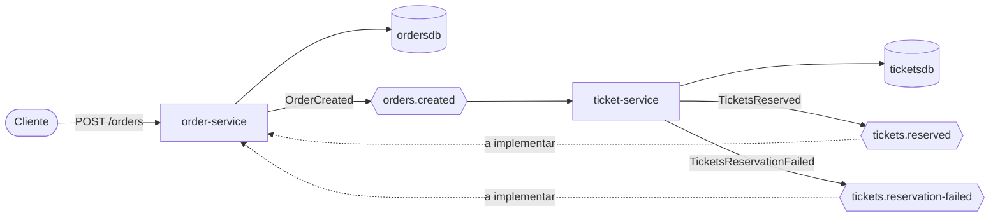

# Ticketing Platform

Plataforma de venda de ingressos baseada em **microserviços orientados a eventos**, construída para praticar o projeto, o teste, a escala e o deploy de um back end Java. O cenário escolhido é o de **alta concorrência**: muitos clientes disputando um estoque limitado de ingressos (como num flash sale), onde a regra mais importante é nunca vender mais do que existe.

> **Status:** em desenvolvimento. O `order-service` e o `ticket-service` estão funcionando e testados. O fluxo ainda não está fechado: o `order-service` não consome as respostas do `ticket-service`, então o pedido continua `PENDING`. Veja o [roadmap](#roadmap).

## Arquitetura



As setas pontilhadas indicam o que ainda não foi implementado.

| Serviço | Responsabilidade | Banco | Porta |
|---|---|---|---|
| `order-service` | Ciclo de vida do pedido (`PENDING`, `CONFIRMED`, `CANCELLED`) | `ordersdb` | 8081 |
| `ticket-service` | Catálogo de shows e estoque de ingressos; reserva atômica | `ticketsdb` | 8082 |

Os serviços **não acessam o banco um do outro** nem compartilham classes: cada um é dono dos seus dados e a comunicação acontece só por eventos no Kafka, com o JSON como contrato.

### Fluxo de uma compra

1. O cliente chama `POST /orders`.
2. O `order-service` grava o pedido como `PENDING` e publica `OrderCreated` em `orders.created`.
3. O `ticket-service` consome o evento e tenta reservar os ingressos de forma atômica. Publica `TicketsReserved` ou `TicketsReservationFailed` (motivo `OUT_OF_STOCK` ou `SHOW_NOT_FOUND`).
4. *(a implementar)* O `order-service` consome a resposta e atualiza o pedido para `CONFIRMED` ou `CANCELLED`.

A API responde `202 Accepted` logo após o passo 2. O resultado final é consultado depois com `GET /orders/{id}`, o que caracteriza consistência eventual.

## Stack

- Java 25 e Spring Boot 4.1
- Spring Data JPA (Hibernate) e PostgreSQL 16
- Flyway para migrations versionadas (o Hibernate apenas valida o esquema)
- Apache Kafka em modo KRaft, sem Zookeeper
- Docker e Docker Compose
- Maven (com wrapper)
- Testcontainers para testes de integração, GitHub Actions para CI e Dependabot para dependências

## Como rodar

### Pré-requisitos

- JDK 25
- Docker Desktop em execução

### 1. Subir a infraestrutura

```bash
docker compose up -d
```

Isso inicia o Kafka, cria os tópicos (`orders.created`, `tickets.reserved`, `tickets.reservation-failed`), dois bancos PostgreSQL e o Kafka UI.

| Componente | Endereço |
|---|---|
| Kafka (para aplicações na máquina) | `localhost:9092` |
| Kafka UI | http://localhost:8090 |
| PostgreSQL de pedidos | `localhost:5433` (db `ordersdb`, usuário e senha `orders`) |
| PostgreSQL de tickets | `localhost:5434` (db `ticketsdb`, usuário e senha `tickets`) |

As credenciais acima são apenas de ambiente local.

### 2. Rodar os serviços

Em dois terminais, um para cada serviço:

```bash
cd order-service
./mvnw spring-boot:run
```

```bash
cd ticket-service
./mvnw spring-boot:run
```

No Windows, use `mvnw.cmd spring-boot:run`. O `order-service` sobe em http://localhost:8081 e o `ticket-service` em http://localhost:8082. Ambos aplicam as migrations do Flyway automaticamente.

### 3. Criar um show e fazer um pedido

Crie um show com 10 ingressos:

```bash
curl -X POST http://localhost:8082/shows \
  -H "Content-Type: application/json" \
  -d '{"name": "Show A", "capacity": 10}'
```

Use o `id` devolvido como `showId` para criar um pedido:

```bash
curl -X POST http://localhost:8081/orders \
  -H "Content-Type: application/json" \
  -d '{
    "userId": "0b9f3f0e-5a38-4a6c-9d5e-1a2b3c4d5e6f",
    "showId": "<id-do-show>",
    "quantity": 2
  }'
```

No PowerShell, use `curl.exe` e escape as aspas do JSON, ou envie as requisições pelo Postman.

A resposta do pedido é `202 Accepted` com status `PENDING`. Em seguida:

- `GET http://localhost:8082/shows/<id-do-show>` deve mostrar `available: 8`.
- No Kafka UI, os tópicos `orders.created` e `tickets.reserved` devem ter uma mensagem cada, com o `showId` e o `orderId` como chaves.

Um pedido maior que o estoque restante gera uma mensagem em `tickets.reservation-failed`.

### Testes

Cada serviço tem um teste de integração com Postgres e Kafka reais em containers (Docker precisa estar rodando):

```bash
cd order-service && ./mvnw test
cd ticket-service && ./mvnw test
```

O do `ticket-service` inclui um cenário de 20 pedidos disputando 5 ingressos, que termina com exatamente 5 reservas, 15 falhas e estoque zerado.

### Parar e limpar

```bash
docker compose stop        # pausa os containers
docker compose down        # remove os containers e mantém os dados
docker compose down -v     # remove tudo, inclusive bancos e tópicos
```

## APIs

### order-service

| Método | Caminho | Descrição | Respostas |
|---|---|---|---|
| `POST` | `/orders` | Cria um pedido e publica `OrderCreated` | `202`, `400` |
| `GET` | `/orders/{id}` | Consulta um pedido | `200`, `404` |

Regras de validação do `POST /orders`: `userId` e `showId` são UUIDs obrigatórios, e `quantity` deve estar entre 1 e 10.

### ticket-service

| Método | Caminho | Descrição | Respostas |
|---|---|---|---|
| `POST` | `/shows` | Cria um show com capacidade e estoque inicial | `201`, `400` |
| `GET` | `/shows/{id}` | Consulta um show e o estoque disponível | `200`, `404` |

Regras de validação do `POST /shows`: `name` não pode ser vazio e `capacity` deve ser no mínimo 1.

## Contrato de eventos

Todos os eventos carregam `messageId` (UUID da mensagem, base da futura idempotência nos consumers) e `occurredAt`.

| Tópico | Evento | Publicado por | Consumido por | Chave |
|---|---|---|---|---|
| `orders.created` | `OrderCreated` | order-service | ticket-service | `showId` |
| `tickets.reserved` | `TicketsReserved` | ticket-service | order-service *(a implementar)* | `orderId` |
| `tickets.reservation-failed` | `TicketsReservationFailed` | ticket-service | order-service *(a implementar)* | `orderId` |

Campos de cada evento:

- `OrderCreated`: `messageId`, `occurredAt`, `orderId`, `userId`, `showId`, `quantity`
- `TicketsReserved`: `messageId`, `occurredAt`, `orderId`, `showId`, `quantity`
- `TicketsReservationFailed`: `messageId`, `occurredAt`, `orderId`, `showId`, `reason`

## Decisões de design

- **Um banco por serviço.** Evita acoplamento ao esquema alheio e mantém a regra de estoque num único lugar.
- **Reserva atômica no banco.** O estoque é reduzido com um único `UPDATE ... WHERE available >= :quantity`, sem "ler, conferir e gravar" na aplicação, e uma constraint `CHECK` no banco recusa estoque negativo mesmo se houver um bug no código.
- **`showId` como chave de `orders.created`.** Todos os pedidos do mesmo show vão para a mesma partição e são processados em ordem. O custo é a possibilidade de uma chave quente num flash sale, tema que será medido nos testes de carga.
- **Resposta assíncrona (`202`).** O pedido é aceito de imediato e confirmado depois, sem prender o cliente à reserva de estoque.
- **Contrato por JSON, sem classes compartilhadas.** Cada serviço tem a sua cópia dos records de evento, e o producer não envia o nome da classe Java nos cabeçalhos.
- **Mensagens inválidas não travam o consumer.** O `ErrorHandlingDeserializer` registra o erro e descarta a mensagem em vez de repeti-la em loop.
- **Flyway no controle do esquema.** O Hibernate roda com `ddl-auto: validate`, então toda mudança de tabela passa por uma migration versionada.
- **Microserviços por objetivo de aprendizado.** Num produto real deste tamanho, um monolito modular seria uma escolha razoável. Aqui a arquitetura distribuída é intencional, para praticar Kafka, sagas, idempotência e escala independente.

## Limitações conhecidas

- **O `order-service` ainda não consome as respostas**, então o pedido nunca sai de `PENDING`.
- **Sem idempotência nos consumers.** Se a mesma mensagem for entregue duas vezes, o `ticket-service` reserva duas vezes. O `messageId` do evento servirá para resolver isso.
- **Gravar no banco e publicar no Kafka são duas operações separadas**, nos dois serviços. Se o processo cair entre as duas, o evento se perde. A correção planejada é o **outbox pattern**.
- Sem liberação de estoque quando um pedido é cancelado (compensação da saga).
- Sem autenticação, gateway nem dead letter topic.
- Os testes de concorrência atuais usam uma única partição, então validam a lógica, mas não a disputa real entre várias threads.

## Integração contínua

O workflow `.github/workflows/ci.yml` roda `./mvnw verify` de cada serviço em paralelo (matrix) a cada pull request e a cada push na `main`, incluindo os testes de integração com Testcontainers. O Dependabot propõe semanalmente atualizações das dependências Maven e das GitHub Actions.

## Estrutura do repositório

```
ticketing-platform/
├── docker-compose.yml     # Kafka, bancos e Kafka UI
├── .github/               # CI (GitHub Actions) e Dependabot
├── order-service/         # Spring Boot: pedidos
│   └── src/main/
│       ├── java/com/ticketing/order/
│       └── resources/db/migration/
└── ticket-service/        # Spring Boot: catálogo e estoque de ingressos
    └── src/main/
        ├── java/com/ticketing/ticket/
        └── resources/db/migration/
```

## Roadmap

- [x] Infraestrutura local com Docker Compose (Kafka KRaft, dois PostgreSQL, Kafka UI)
- [x] `order-service`: `POST /orders` e `GET /orders/{id}` publicando `OrderCreated`
- [x] Teste de integração do `order-service` com Testcontainers
- [x] Pipeline de CI com GitHub Actions e Dependabot
- [x] `ticket-service`: catálogo, reserva atômica de estoque e teste de integração
- [ ] Consumers no `order-service` (`CONFIRMED` e `CANCELLED`) e teste do fluxo completo
- [ ] Idempotência nos consumers, retry e dead letter topic
- [ ] Outbox pattern
- [ ] Tratamento padronizado de erros da API
- [ ] Pagamento e compensação da saga (liberação de estoque)
- [ ] Observabilidade (Prometheus e Grafana)
- [ ] Testes de carga (Gatling ou k6) e otimização do gargalo de estoque
- [ ] Deploy na AWS (ECS com Fargate) com Terraform e autoscaling
- [ ] ADRs e documentação de resultados
